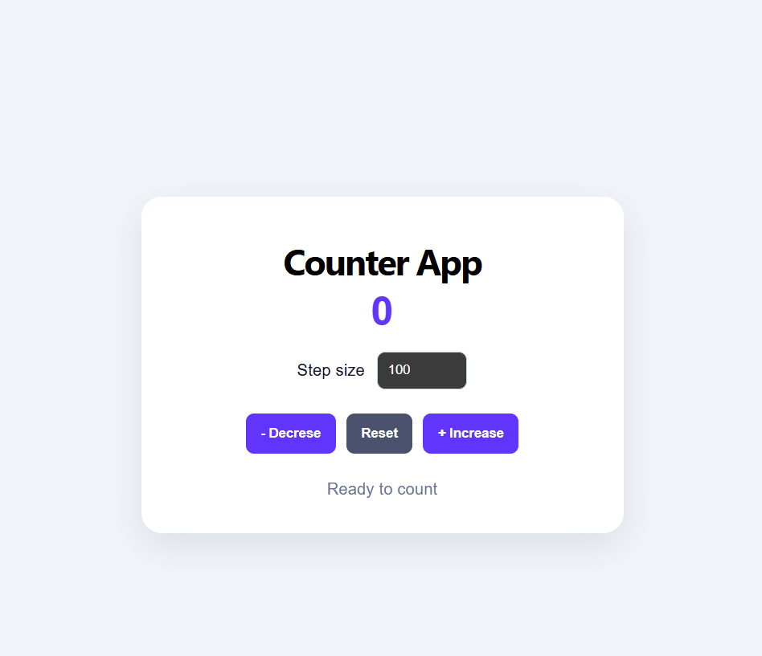

# Project 02 — React Counter App

## Concepts learned
- Function components and JSX
- useState and state updates
- Click event handlers
- Props and reusable components
- Controlled inputs
- Conditional rendering

## Features
- Increment and decrement
- Reset counter
- Custom step size
- Dynamic status message

## Run locally
npm install
npm run dev

## Tech stack
React, Vite, JavaScript, CSS

